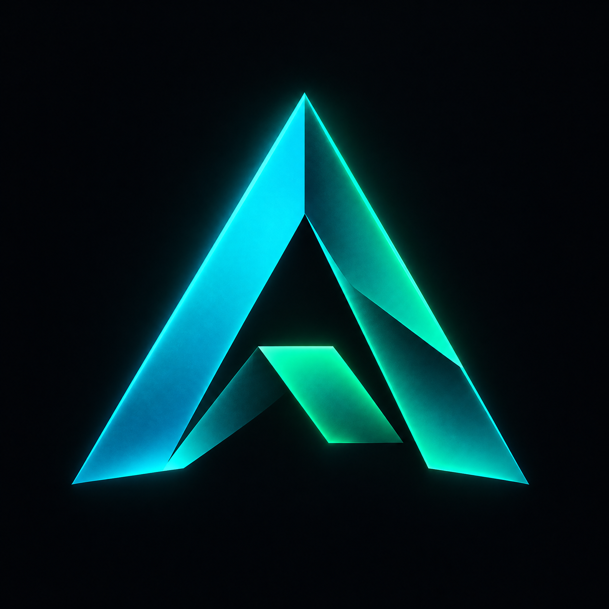

# Hi there, I'm Abdulvohid 👋

  <strong>Frontend developer turning thoughtful ideas into polished digital experiences.</strong> 
  <em>I design responsive React interfaces that feel clear, purposeful, and effortless to use.</em> 
  <em>My work blends visual craft, accessible interactions, and maintainable code.</em> 
  <em>Now growing toward TypeScript, backend engineering, and full-stack product development.</em>

<blockquote align="center">
  <b>Good products feel simple on the surface and thoughtful underneath.</b>
</blockquote>

  
  
  

  

<table align="center">
  <tr>
    <td align="center" width="25%"><b>⚛️ Focus</b> React & UI</td>
    <td align="center" width="25%"><b>🧠 Learning</b> TypeScript & APIs</td>
    <td align="center" width="25%"><b>📍 Based in</b> Namangan, Uzbekistan</td>
    <td align="center" width="25%"><b>🌐 Portfolio</b> <a href="https://abdulvohidportfolio.netlify.app/">Visit website</a></td>
  </tr>
</table>

✦ Building with purpose · Learning in public · Improving every iteration ✦

<table align="center">
  <tr>
    <td align="center" width="33%"><h3>01</h3><b>Interface Craft</b> Clean layouts, responsive systems, and meaningful interactions.</td>
    <td align="center" width="33%"><h3>02</h3><b>Product Mindset</b> Turning ideas into useful experiences with clear user journeys.</td>
    <td align="center" width="33%"><h3>03</h3><b>Continuous Growth</b> Learning TypeScript, APIs, and full-stack product engineering.</td>
  </tr>
</table>

## 👨‍💻 About Me

I’m a frontend developer from **Namangan, Uzbekistan**, passionate about creating digital experiences that feel simple, fast, and intentional. I enjoy transforming product ideas into polished interfaces with thoughtful layouts, responsive behavior, clear interaction patterns, and a strong attention to detail.

My current journey is taking me beyond the browser: I’m deepening my knowledge of **TypeScript**, exploring **backend development**, and learning how to design complete, maintainable full-stack products. Every project is an opportunity to improve my craft, experiment with new ideas, and build something useful.

<table>
  <tr>
    <td width="50%">
      <h3>⚡ What I do</h3>
      <ul>
        <li>Build responsive React interfaces</li>
        <li>Design practical user experiences</li>
        <li>Create interactive frontend demos</li>
        <li>Turn concepts into polished products</li>
      </ul>
    </td>
    <td width="50%">
      <h3>🎯 What I’m working toward</h3>
      <ul>
        <li>Stronger TypeScript architecture</li>
        <li>Backend and API fundamentals</li>
        <li>Full-stack application development</li>
        <li>Better accessibility and performance</li>
      </ul>
    </td>
  </tr>
</table>

- 📍 Based in **Namangan Region, Uzbekistan**
- 🌐 Portfolio: **[abdulvohidportfolio.netlify.app](https://abdulvohidportfolio.netlify.app/)**
- 💬 Interested in: **frontend development, product design, React, and full-stack growth**
- 🤝 Open to: **collaboration, constructive feedback, and ambitious learning projects**

## 🌱 My Developer Journey

I started with a curiosity about how websites work and gradually turned that curiosity into a passion for building interfaces. Today, I enjoy the entire process: understanding a problem, shaping a clear user flow, translating the idea into a responsive layout, and refining the details until the experience feels right.

My goal is not only to write code that works, but to create products that communicate clearly and feel natural to use. I care about visual hierarchy, readable code, reusable components, thoughtful states, and the small interactions that make a digital experience feel complete.

<table>
  <tr>
    <td align="center" width="33%"><strong>01</strong> Explore the idea Understand the problem and the people using it.</td>
    <td align="center" width="33%"><strong>02</strong> Build the experience Turn the concept into a responsive, usable interface.</td>
    <td align="center" width="33%"><strong>03</strong> Refine the details Improve accessibility, performance, and polish.</td>
  </tr>
</table>

## 🎯 Current Focus

| Area | What I’m learning and building |
| --- | --- |
| **Frontend** | Reusable React components, responsive layouts, state-driven interfaces, and accessible interactions |
| **TypeScript** | Stronger types, safer architecture, and more maintainable application code |
| **Backend** | APIs, data flow, authentication concepts, and the foundations of full-stack products |
| **Product thinking** | Clear user journeys, useful features, visual hierarchy, and purposeful design decisions |

## 🗺️ Learning Roadmap

- ✅ Responsive HTML and CSS foundations
- ✅ JavaScript and interactive browser experiences
- ✅ React component-based development
- 🔄 TypeScript and scalable frontend architecture
- 🔄 APIs, backend fundamentals, and databases
- 🔜 End-to-end full-stack applications with polished user experiences

## 🧠 What I Value

> **Clarity over complexity. Consistency over shortcuts. Progress over perfection.**

I value interfaces that are easy to understand, code that is easy to continue, and products that solve a real problem. I’m always trying to learn from each project, improve the way I work, and become a more thoughtful engineer with every iteration.

## 🧰 Tech Stack & Skills

### Frontend Foundation

 

### Tools & Full-Stack Direction

## 🚀 Featured Work

<em>A selection of interfaces, dashboards, and product experiments built while learning and growing.</em>

<table>
  <tr>
    <td width="50%">
      <h3><a href="https://github.com/Abdulvoh1d/galaxy-e-commerce-demo">🛒 Galaxy E-Commerce</a></h3>
      
A polished product discovery experience with a working browser cart and simulated checkout flow.

      <a href="https://galaxy-ecommerce-demo.netlify.app">Live Demo →</a>
    </td>
    <td width="50%">
      <h3><a href="https://github.com/Abdulvoh1d/taskflow-dashboard-demo">✅ TaskFlow Dashboard</a></h3>
      
An interactive task board with filters, clear visual states, and browser-local persistence.

      <a href="https://taskflow-dashboard-demo-668s.netlify.app">Live Demo →</a>
    </td>
  </tr>
  <tr>
    <td width="50%">
      <h3><a href="https://github.com/Abdulvoh1d/social-media-analytics-demo">📈 Social Media Analytics</a></h3>
      
A metrics dashboard with charts, filters, sample insights, and CSV export functionality.

      <a href="https://social-media-analytics-demo.netlify.app">Live Demo →</a>
    </td>
    <td width="50%">
      <h3><a href="https://github.com/Abdulvoh1d/e-learning-platform-demo">🎓 E-Learning Platform</a></h3>
      
A course experience with lesson navigation, quizzes, and browser-local progress tracking.

      <a href="https://elearning-platform-demo.netlify.app">Live Demo →</a>
    </td>
  </tr>
  <tr>
    <td width="50%">
      <h3><a href="https://github.com/Abdulvoh1d/restful-api-gateway-demo">🔌 API Gateway Console</a></h3>
      
A local request and response simulator for exploring API workflows and developer tooling.

      <a href="https://restful-api-gateway-demo.netlify.app">Live Demo →</a>
    </td>
    <td width="50%">
      <h3><a href="https://github.com/Abdulvoh1d/crypto-tracker-pro-demo">₿ Crypto Tracker Pro</a></h3>
      
A watchlist and chart experience powered by illustrative sample market data.

      <a href="https://crypto-tracker-pro-demo.netlify.app">Live Demo →</a>
    </td>
  </tr>
</table>

> These are independent frontend demos. Simulated flows and sample data are clearly identified in each project.

## 📊 GitHub Activity

 

## 🏆 Profile Highlights

<em>Small steps, consistent practice, and real projects — that’s how I’m building my path forward.</em>

## 💡 My Development Philosophy

> **Build with intention. Learn continuously. Improve every interaction.**

I believe good frontend work is more than making a page look attractive. It is about clarity, accessibility, performance, and the small details that make an experience feel effortless.

## 📫 Let’s Connect

<strong>Have an idea, a challenge, or a project worth building?</strong> <em>I’m always open to thoughtful conversations and meaningful collaboration.</em>

  

<a href="https://github.com/Abdulvoh1d">GitHub</a> · <a href="https://abdulvohidportfolio.netlify.app/">Portfolio</a> · <a href="https://github.com/Abdulvoh1d?tab=repositories">Repositories</a>

  

